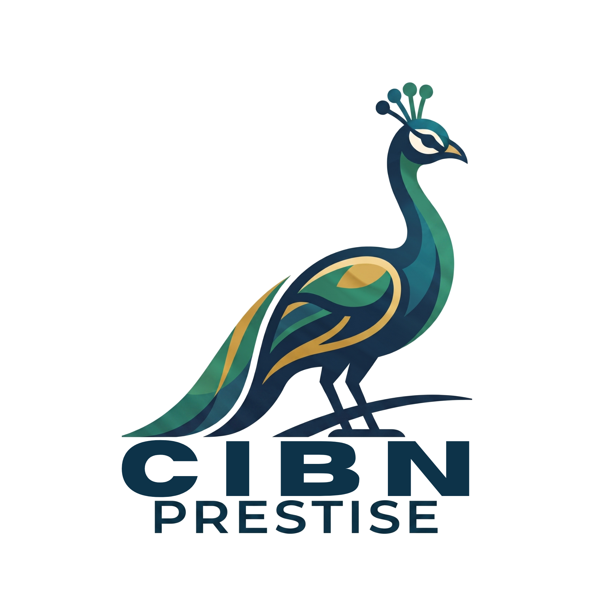
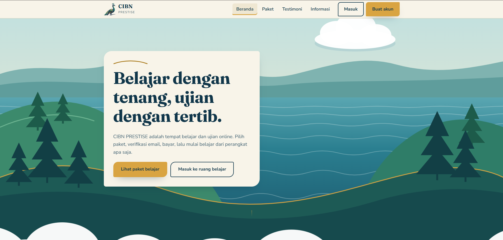
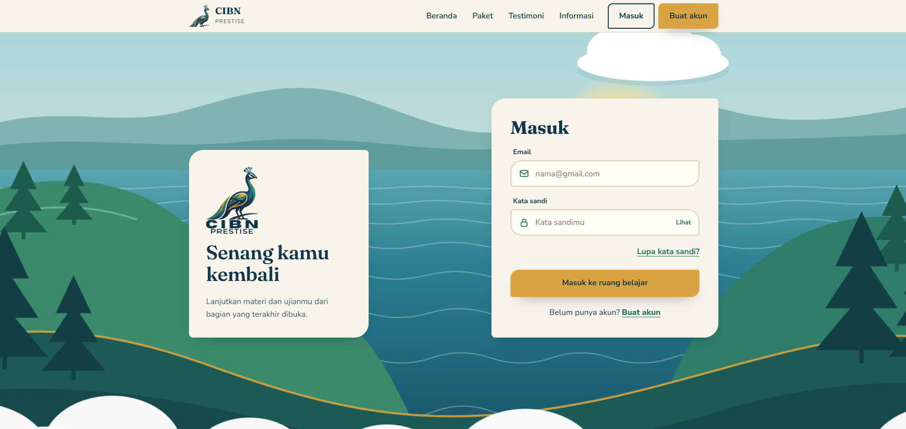
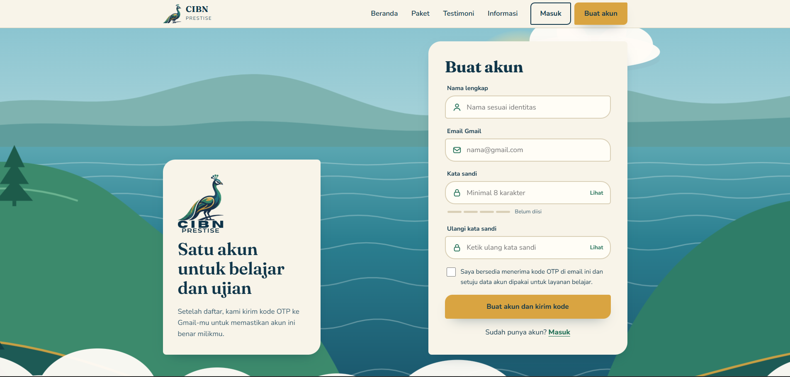

  

<h1 align="center">CIBN PRESTISE</h1>

  Platform belajar dan ujian online dengan tiga peran: peserta, guru, dan admin.

  <a href="https://www.cibnprestise.com"><b>www.cibnprestise.com</b></a>

---

## Tampilan

| Masuk | Buat akun |
|---|---|
|  |  |

Halaman publik memakai ilustrasi pemandangan danau dan perbukitan dengan burung merak sebagai maskot, dipadukan warna hijau tua dan emas.

## Tentang proyek

CIBN PRESTISE mengumpulkan materi, e-book, ujian, jadwal belajar, dan pembayaran paket di satu web. Peserta memilih paket, memverifikasi email, membayar, lalu belajar dari perangkat apa saja. Guru memantau dan membahas hasil ujian. Admin mengurus seluruh isi dan operasional.

## Fitur

### Peserta
- Ujian dengan timer otomatis, dibuka lewat token atau modul dari paket
- Riwayat ujian beserta kode laporan
- Mode review untuk melihat jawaban sendiri, kunci, dan pembahasan
- E-book sesuai paket yang dimiliki
- Jadwal sesi belajar: ajukan, lihat, dan batalkan
- Beli paket dan bayar langsung dari akun

### Guru
- Melihat hasil ujian seluruh peserta
- Membahas jawaban peserta dengan tampilan seperti soal ujian asli, lengkap dengan kunci dan pembahasan
- Mengatur ketersediaan dan mengelola jadwal sesi
- Laporan dan e-book

### Admin
- Bank soal, modul, dan materi, dengan editor yang mendukung rumus matematika
- Pembuatan token ujian dan pengaturan timer
- Manajemen akun, grup, paket, dan keuangan
- Analisa hasil dalam bentuk grafik, bisa diekspor
- Pengelola isi web publik: landing, testimoni, artikel, informasi, dan legal

## Jenis ujian

| Jenis | Bagian |
|---|---|
| SKD | TWK, TIU, TKP, atau semuanya sekaligus, dengan sistem penilaian sendiri |
| TOEFL | Listening, Structure, Reading |
| CAT | Mode ujian berbasis komputer |

## Alur peserta

1. Buat akun
2. Verifikasi kode OTP yang dikirim ke Gmail
3. Pilih paket dan bayar
4. Masuk ke ruang belajar dan mulai

## Teknologi

- Node.js dan Express
- PostgreSQL
- HTML, CSS, dan JavaScript tanpa framework frontend
- Tes unit dan end-to-end untuk sistem ujian

## Link

[www.cibnprestise.com](https://www.cibnprestise.com)
